# Seyal AI System Architecture

This document details the modular subsystem architecture of **Seyal AI**, explaining data flows, component relationships, and concurrency models.

---

## 1. High-Level Architecture Diagram

```mermaid
graph TD
    User([User Voice / Text / API]) --> Gateway[API Gateway / CLI / Voice Loop]
    
    subgraph "Core Orchestration & Intelligence Layer"
        Gateway --> Brain[SeyalAiBrain]
        Brain --> Identity[Identity & Wake Word Manager]
        Brain --> Personalization[PersonalizationManager - Tone & Preferences]
        Brain --> SecurityGuard[Security & Safety Guardrails Enforcer]
        Brain --> ModelRouter[Multi-Model Router]
        Brain --> TaskManager[TaskManager & Execution Engine]
        Brain --> MemoryMgr[Unified Memory & Semantic Vector Store]
    end

    subgraph "Autonomous Planning & Execution Engine"
        TaskManager --> TaskPlanner[TaskPlanner - Goal Decomposition]
        TaskManager --> ToolSelector[ToolSelector & Param Interpolation]
        TaskManager --> ExecutionEngine[PlanExecutionEngine]
        TaskManager --> ProgressTracker[ProgressTracker & Telemetry Hub]
        TaskManager --> RetrySystem[Retry & Self-Correction System]
        TaskManager --> ResultVerifier[ResultVerifier]
        TaskManager --> Cancellation[Cancellation & Universal Kill Switch]
    end

    subgraph "Capability & Integration Layer"
        ExecutionEngine --> ToolRegistry[Unified ToolRegistry]
        ToolRegistry --> LaptopAgent[Laptop Agent - OS, Files, Apps]
        ToolRegistry --> AndroidAgent[Android Agent - ADB, Taps, Transfer]
        ToolRegistry --> BrowserAgent[Browser Agent - Playwright Automation]
        ToolRegistry --> VisionAgent[Vision Agent - OCR, Screen Awareness]
        ToolRegistry --> McpManager[Model Context Protocol - Dynamic MCP Servers]
    end

    subgraph "Background Engines & Automation"
        Scheduler[AutomationScheduler] --> ExecutionEngine
        Scheduler --> Storage[(automations.json)]
        Dispatcher[NotificationDispatcher] --> Webhooks([Discord / Slack / Telegram])
        Maintenance[SystemMaintenance] --> DataPurge[Storage Cleanup & Vacuum]
    end

    subgraph "Event Bus & Storage Subsystem"
        Brain -.-> EventBus[Async EventBus]
        ProgressTracker -.-> EventBus
        EventBus -.-> AudioFeedback[Audio Feedback / Earcons]
        MemoryMgr --> VectorStore[(Dual-Mode Vector Store - Gemini / Local L2 N-Gram)]
        MemoryMgr --> SQLite[(SQLite Relational DB + Aiosqlite)]
        SecurityGuard --> Vault[(AES-GCM Secret Vault & safety.json)]
    end
```

---

## 2. Subsystem Breakdown

### 1. Core Brain & Orchestration (`seyal_ai.core`)
- **`SeyalAiBrain`**: Central lifecycle coordinator. Routes input through emergency checks, custom macros, offline fallback, safety guardrails, semantic long-term memory recall, and multi-step plans.
- **`ModelRouter`**: Dynamically dispatches prompts to optimal models across 4 tiers:
  - `FAST`: Gemini 2.0 Flash / GPT-4o-mini
  - `SMART`: Claude 3.5 Sonnet / GPT-4o
  - `VISION`: Gemini 2.0 Pro Multimodal
  - `LOCAL`: Ollama (Llama 3 / Mistral)
- **`ContextManager`**: Maintains multi-turn conversation memory, sliding working window, and dynamic system prompt generation.

### 2. Autonomous Planning Engine (`seyal_ai.planning`)
- **`TaskPlanner`**: Breaks compound goals into dependency-ordered `PlanStep` graphs.
- **`ToolSelector`**: Matches step descriptions to 60+ system tools plus external MCP tools, performing runtime parameter interpolation (`{{step_1.output}}`).
- **`PlanExecutionEngine`**: Sequentially executes steps, validates intermediate results, triggers confirmations for risky actions, and performs verification checks.
- **`CancellationManager`**: Manages cooperative `CancellationToken` signals and immediate hard process kills (`EMERGENCY STOP`).

### 3. Unified 6-Category Memory & Vector Store (`seyal_ai.memory`)
1. **Working Memory**: Current conversation turn context.
2. **Short-Term Memory**: Session history and ephemeral task scratchpad.
3. **Long-Term Memory**: Persistent facts, profile attributes, and learned user habits.
4. **Episodic Memory**: Past executed plans, transcripts, and interaction history.
5. **Semantic Memory & Vector Store (`seyal_ai.memory.vector_store`)**:
   - **Online Embeddings**: Google Gemini `text-embedding-004` (768-dim) for high-accuracy semantic embeddings.
   - **Local Deterministic Embeddings**: Subword n-gram vectorizer (256-dim) with L2 normalization for instant offline semantic indexing and recall.
   - **Semantic Pre-Orchestration Recall**: Automatically retrieves the 3 most relevant memories and injects them into the Brain reasoning loop prior to execution.
6. **Procedural Memory**: Custom macros, multi-step workflows, and execution templates.

### 4. Device & Agent Execution Layer (`seyal_ai.agents`, `seyal_ai.devices`)
- **`LaptopAgent`**: 64 system automation tools (file search, conversion, window management, audio control).
- **`AndroidAgent`**: ADB automation (touch gestures, app launches, notifications, file sync).
- **`BrowserAgent`**: Headless/headful Playwright web automation.
- **`VisionAgent`**: Screen capture with Per-Monitor v2 DPI awareness, OCR text extraction, UI element bounding box recognition.
- **`ConversationalComputerUseAgent`**: Direct computer automation with Set-of-Marks grounding, Semantic UIA targeting (click by accessibility name before coordinate fallback), and multilingual voice shortcuts (English, Tamil, Tanglish).

### 5. Extensibility & MCP Integration (`seyal_ai.mcp`)
- **`McpManager`**: Coordinates multiple external Model Context Protocol server processes (stdio / JSON-RPC).
- **`DynamicMcpTool`**: Dynamically wraps external tools from connected MCP servers and registers them into Seyal AI's `ToolRegistry`.
- **Persistence**: Server configurations and active states stored persistently in `~/.seyal_ai/mcp_servers.json`.

### 6. Scheduled Automations & Desktop Routines (`seyal_ai.automation.scheduler`)
- **`AutomationScheduler`**: Background daemon orchestrating recurring (daily, interval-based) or manual autonomous desktop workflows.
- **Telemetry & Status Tracking**: Tracks execution runs, intermediate output artifacts, step outcomes, and failure recovery.
- **Persistence**: Routines stored in `~/.seyal_ai/automations.json`.

### 7. Deep Personalization & Communication Profiles (`seyal_ai.personalization`)
- **`PersonalizationManager`**: Configures assistant tone (`action`, `executive`, `copilot`, `mentor`), custom user instructions, proactive suggestions, and language auto-switching.
- **Reasoning Injection**: Injects tailored behavioral directives into the core system prompt on every execution turn.
- **Persistence**: Saved in `~/.seyal_ai/personalization.json`.

### 8. Enterprise Safety Guardrails & Policy Enforcement (`seyal_ai.security.guardrails`)
- **Safety Profiles**: `zero_trust`, `balanced`, and `developer`.
- **Sensitive App Protection**: Blocks unauthorized interaction with password managers (Bitwarden, 1Password, KeePass) and banking/payment checkout portals.
- **System Boundary Enforcement**: Blacklists protected directories (e.g. `C:\Windows\System32`), blocks destructive actions, prevents self-kill of agent processes, and automatically masks API keys and credit card numbers in logs and telemetry.
- **Persistence**: Configured in `~/.seyal_ai/safety.json`.

### 9. Multi-Channel Notifications & Webhooks (`seyal_ai.notifications`)
- **`NotificationDispatcher`**: Handles outbound HTTP webhook notifications to Discord, Slack, Telegram, and custom webhook endpoints with latency measurement.
- **Audit Logging**: Maintains persistent historical event logs in `~/.seyal_ai/notification_history.json`.

### 10. System Maintenance & Storage Footprint Management (`seyal_ai.api.routes.system_maintenance`)
- **Live Footprint Analytics**: Real-time disk size tracking across vision captures, vector stores, audio recordings, SQLite databases, and logs.
- **Granular Cleanup & Optimization**: On-demand purging of temporary frames/audio, log rotation, and SQLite database `VACUUM` optimization.
- **Data Privacy**: Granular conversation purges, user knowledge vault wipe, and nuclear factory reset.

---

## 3. Concurrency & Reliability Model

- **Asynchronous Event Loop**: Built on Python `asyncio` with non-blocking I/O.
- **Background Support Tasks**: Long-running dev servers and watchers run as daemon subprocesses.
- **Zero Polling Reactive Wakeup**: EventBus and background workers communicate reactively via async notifications and callbacks.
